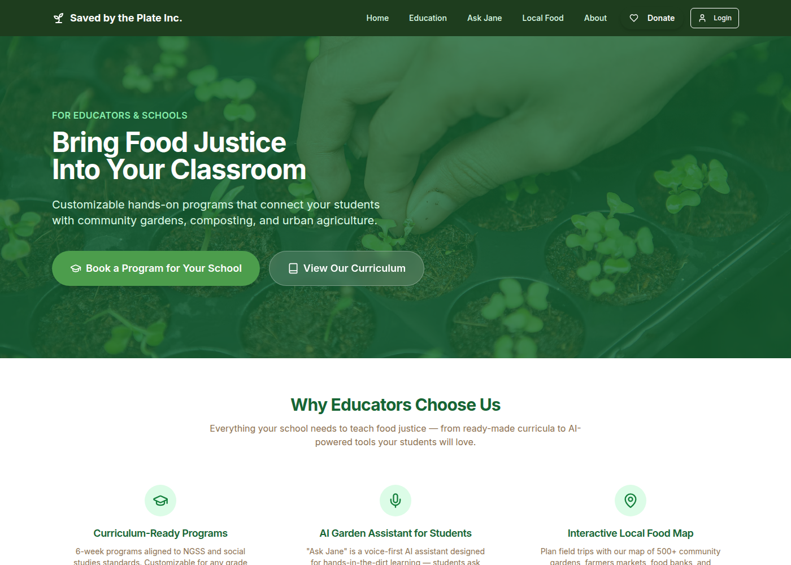
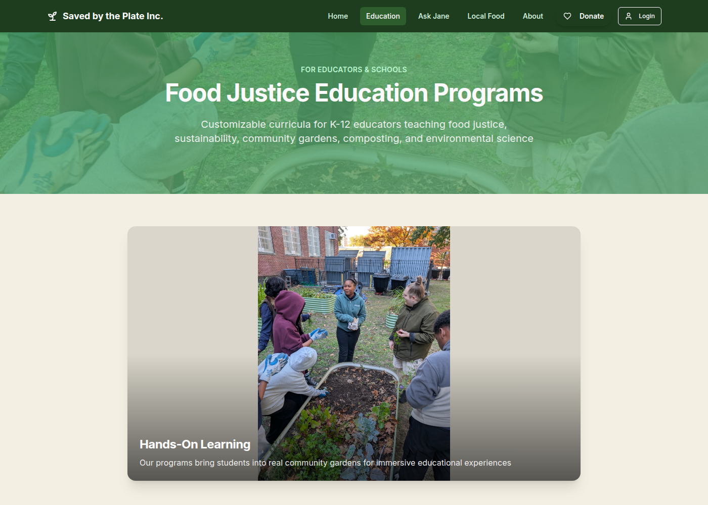
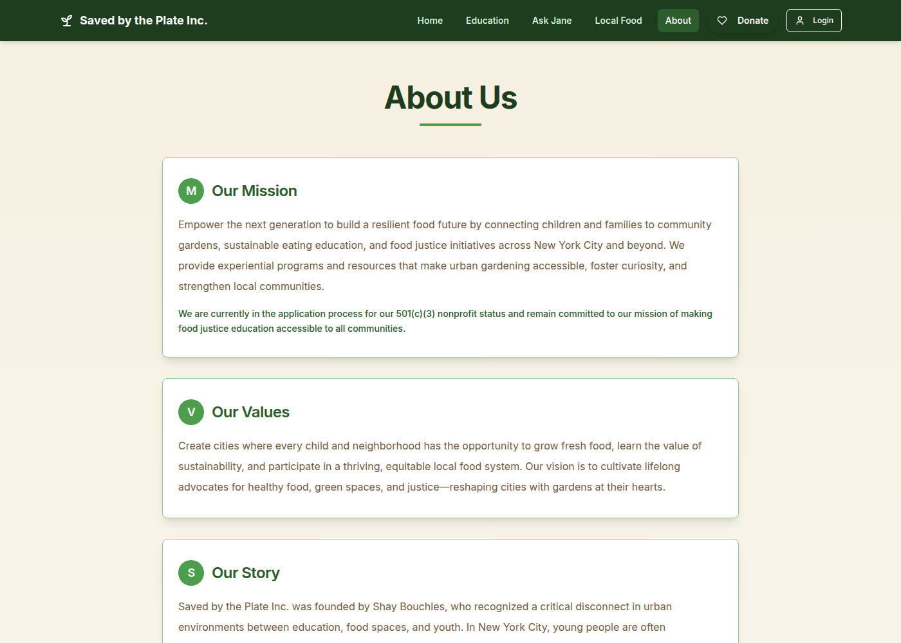
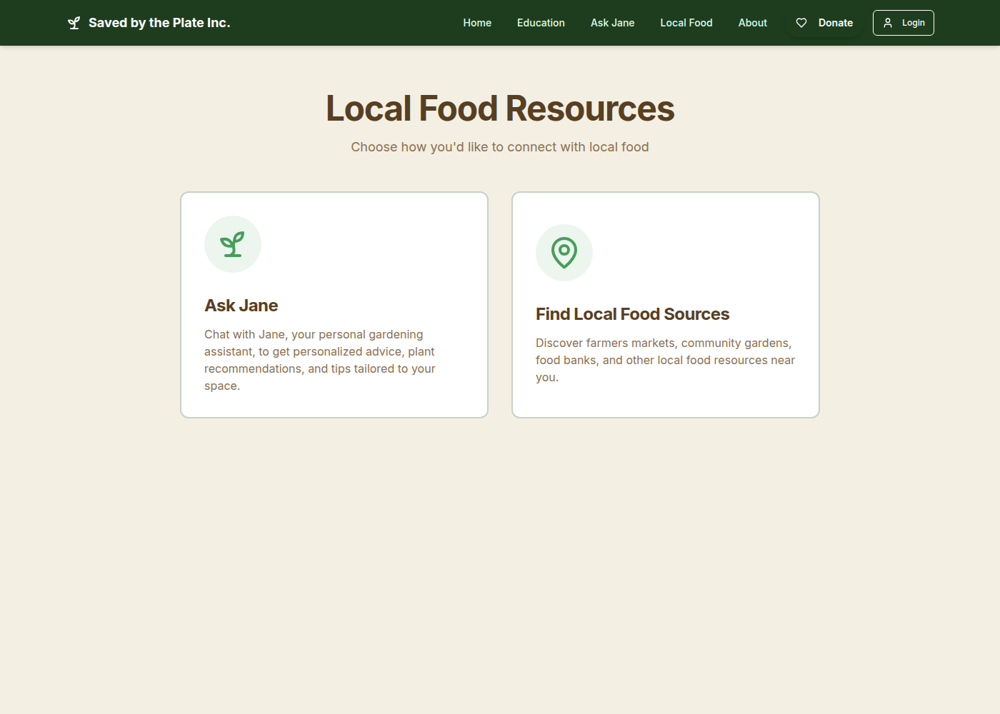
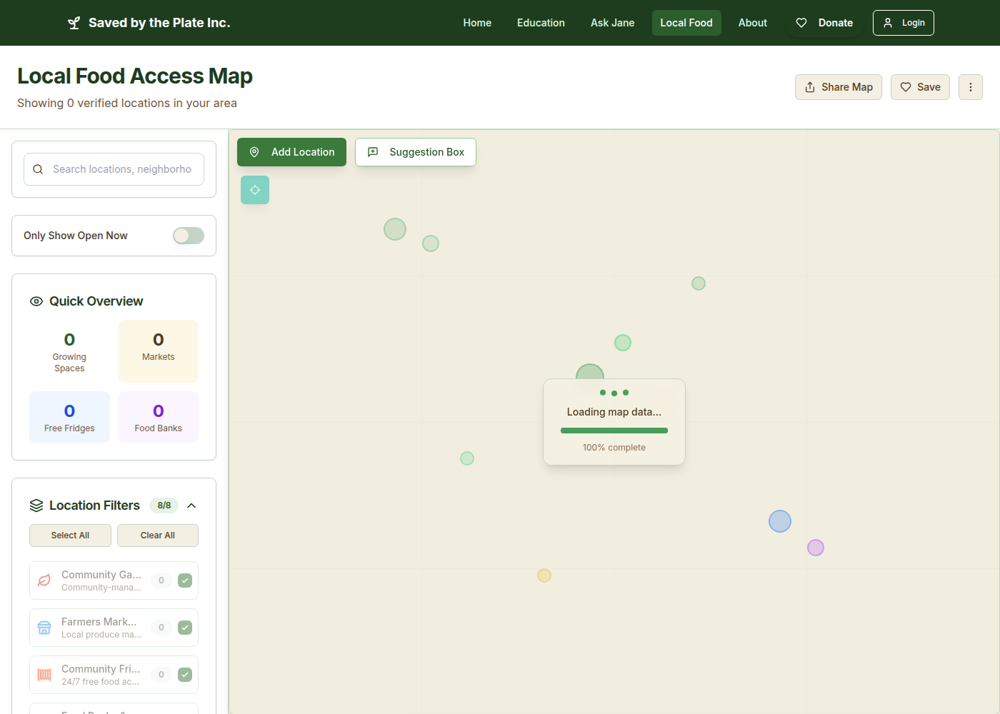
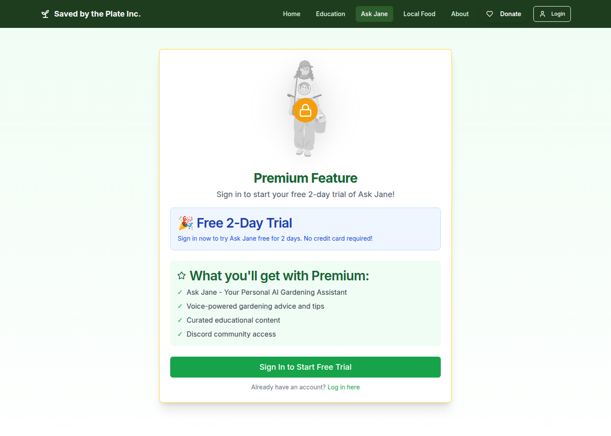

# Saved by the Plate

Website for [Saved by the Plate Inc.](https://www.savedbytheplate.org), a New York City nonprofit focused on food-justice education. The app is a Vite + React site for school programs, a map of locally sourced food, and Jane, an AI garden planner.

**The public site is offline.** On October 14, 2026, `https://www.savedbytheplate.org` redirected to `https://savedbytheplate.org`, which returned **404** with the response header `x-lovable-serve-error: cloudflare_no_published_file`. Nothing is published from the Lovable project right now. The screenshots below are from a local dev server.

The organization describes itself, on the About page, as still in the application process for 501(c)(3) status.

## Mission

From the About page:

> Empower the next generation to build a resilient food future by connecting children and families to community gardens, sustainable eating education, and food justice initiatives across New York City and beyond.

The site is aimed at educators and schools. It offers hands-on programs for primary and secondary students (presented in the product as customizable K-12 curricula), a map for finding local food, and Jane for garden planning in and out of the classroom.

## Features

These are the routes and behaviors in this repository.

- **School programs** (`/education`). Two on-site youth programs, each laid out as six weeks: *Community Gardens & Food Justice* and *Composting, Soil Science & Sustainability*. Copy on the page says length and content can be a single session, a 6-week series, or a 12-week semester. Schools request a program through the contact form (`/contact`), which posts to the `submit-contact-form` Supabase function.
- **Ask Jane** (`/local-food/garden-planner`). A voice-first garden assistant. Signed-in subscribers (or a 2-day trial) talk to Jane over a WebSocket to the `voice-ask-live` edge function, which uses Google Gemini and can call tools. Classroom Mode lets a teacher run a group session, collect student updates, and award badges. Without a session, the page shows the trial / premium gate.
- **Local food map** (`/local-food/map`). Google Map of verified, active rows from the Supabase `public_locations` view: community gardens, farmers markets, community fridges, food banks, farms, urban farms, businesses, and CSAs. The page can search, filter, and submit a new location or a correction. Contact fields are not selected from the public view.
- **Accounts and support.** Supabase email auth (`/auth`) and profiles (`/profile`). Stripe-backed donations in the nav, and subscription plans on `/premium` (monthly, annual, and educator). A footer form calls `subscribe-to-beehiiv`.
- **Other pages.** About, FAQ, privacy, and terms. `/foraging-test` is an unlinked draft that uses mock data.

## Tech stack

| Layer | What this repo uses |
| --- | --- |
| Frontend | Vite 5, React 19, TypeScript, React Router 7, Tailwind CSS, shadcn/ui (Radix), TanStack Query |
| Data and auth | Supabase (Postgres, Auth, Edge Functions) |
| Payments | Stripe (publishable key in the client; checkout via edge functions) |
| Maps | Google Maps JavaScript API, loaded with a key from the `get-google-maps-key` function |
| Jane | Gemini through `voice-ask-live`, plus a Python planner API |
| Planner service | FastAPI app in `backend/` (Dockerfile targets Cloud Run). Edge functions call `BACKEND_API_URL`, defaulting to `https://voiceagentrender.onrender.com` |
| Map collection | Separate repo [`map_scrapper`](https://github.com/shaythegay13/map_scrapper). This repo also keeps CSV snapshots in `public/processed/` and older Python processors in `src/data/scripts/` |
| Planner source | Separate repo [`agenticaigardenplanner`](https://github.com/shaythegay13/agenticaigardenplanner). A copy of that style of planner lives in `backend/` here |

`npm ci` needs `legacy-peer-deps` because `cmdk@1.0.0` peers React 18 and this app depends on React 19. That flag is set in `.npmrc`.

## Architecture

```text
Browser (Vite / React)
  ├─ Supabase Auth, profiles, public_locations
  ├─ Edge Functions
  │    ├─ voice-ask-live  → Gemini Live (Jane)
  │    ├─ generate-smart-garden-plan, analyze-plant-disease, voice-ask
  │    │     → BACKEND_API_URL (Python planner)
  │    ├─ create-checkout / check-subscription → Stripe
  │    ├─ submit-contact-form, subscribe-to-beehiiv
  │    └─ get-google-maps-key → Maps JS
  └─ Stripe.js donations (publishable key)

map_scrapper  →  location rows in Supabase  →  /local-food/map
agenticaigardenplanner  →  planner API used by Jane's edge functions
```

The live map does not read the CSV files directly. `src/services/enhancedMapDataService.ts` pages through `public_locations`. The Python scripts and `public/processed/*.csv` files are the older collection pipeline that still sits in this tree.

Jane's voice session is implemented here (`src/hooks/useVoiceLive.ts` and `supabase/functions/voice-ask-live`). Garden-plan generation is delegated to the Python API (`/api/v1/garden-plan/generate` and `/api/conversation`).

## Local setup

Requirements: Node.js 20+ and npm. Python 3.12 is only needed for the data scripts or the FastAPI backend.

```sh
git clone https://github.com/shaythegay13/savedbytheplate.git
cd savedbytheplate
cp .env.example .env   # fill in values locally; do not commit .env
npm ci
npm run dev            # http://127.0.0.1:8080
```

`.env` names:

- `VITE_SUPABASE_PROJECT_ID`
- `VITE_SUPABASE_PUBLISHABLE_KEY`
- `VITE_SUPABASE_URL`
- `VITE_STRIPE_PUBLISHABLE_KEY`

The Supabase URL and anon key are also hardcoded in `src/integrations/supabase/client.ts` (Lovable generates that file). The anon key and the Stripe publishable key are public by design. Do not put the Supabase service-role key, Stripe secret key, or Gemini key in this repo.

The map and Jane need the hosted Supabase project and its function secrets (including the Google Maps key). A local run without those still renders the pages; the map will not load locations or the Maps script.

Optional Python backend:

```sh
pip install -r requirements.txt
uvicorn backend.api:app --host 127.0.0.1 --port 8081
```

Data-script checks live under `src/data/` (`pytest`, `black`, `ruff`). See `.github/workflows/`.

## Screenshots

Local `npm run dev` on October 14, 2026. No account was signed in. The map request to Supabase returned no rows, and the Maps script reported that the Google Maps API key secret is not configured, so the map screenshot is the page shell rather than a populated map.

### Home



### Education



### About



### Local food



### Map



### Ask Jane



## Contributors

From `git shortlog`:

- **Shay Bouchles** — founder, and the repository owner (commits under Shay Bouchles, `shaythegay13`, and `shaybouchles`).
- **Sabih Sarowar** — local development notes and a small fix, October 12, 2025 (`docs & fix: sabih's local development guide and steps for fixing the issue`).
- **Lovable** (`gpt-engineer-app[bot]`) — the majority of commits. This repository is synced from the Lovable project, so history should not be rewritten.

## License

No license file is present in this repository.
